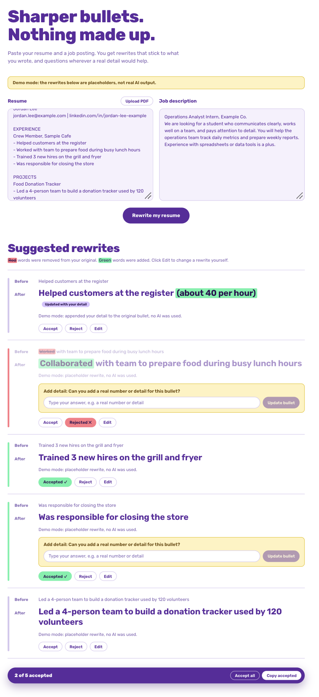
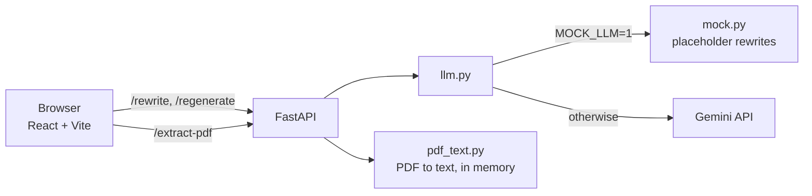

# AI Resume Rewriter

Rewrites your resume bullets to fit a job posting **without inventing anything**. When a bullet is missing a real detail, it asks you for it instead of making one up.



## What it does

- **Paste or upload** your resume (text, or a PDF) and a job description.
- **Gets a rewrite for each bullet** from the Gemini API, with a one-line reason for every change.
- **Shows exactly what changed** with a word-level diff: red words were removed, green words were added. Anything the model adds stands out.
- **Asks follow-up questions** where a real number or detail would help. Type your answer and only that bullet is regenerated.
- **Lets you decide:** accept, reject, or edit any rewrite by hand, then copy everything you accepted.
- **Has a demo mode** that runs with no API key, so anyone can try the interface.

## How it avoids making things up

A resume tool that invents numbers is worse than no tool, so this is built around not doing that:

- The prompt bans adding duties, topics, frequencies ("nightly"), qualities ("quickly", "comprehensive"), conditions, tools, numbers, or team sizes that aren't in the original bullet. It also bans pulling skills from the job description that your bullet doesn't mention.
- A bullet with no metric gets a **question**, not an invented number (`missing_info`).
- The only way new facts enter a rewrite is **you typing them** into the follow-up box.
- The diff makes any addition visible, and the original text can never be altered by the model (the backend overwrites it).

These are prompt-level guardrails, so they reduce fabrication but can't guarantee it. I checked behavior by hand on a few inputs and tightened the prompt after finding leaks (for example, "nightly" and "security checklists" appearing from nowhere). An automated evaluation is on the roadmap.

## Architecture



| Endpoint | Purpose |
|---|---|
| `POST /rewrite` | Rewrite every bullet in a resume for a job description |
| `POST /regenerate` | Rewrite one bullet using a detail the user typed in |
| `POST /extract-pdf` | Turn an uploaded PDF into text (nothing is stored) |
| `GET /health` | Status, and whether the backend is in demo mode |

**Stack:** React 19 + Vite on the front end; Python + FastAPI + Pydantic on the back end; Gemini API through the `google-genai` SDK; `pdfplumber` for PDF text.

## Run it locally

You need Python 3.10+ and Node 22+.

```bash
# Backend
cd backend
python3 -m venv .venv
source .venv/bin/activate
pip install -r requirements.txt
cp .env.example .env          # then edit .env (see below)
python -m uvicorn main:app --reload
```

```bash
# Frontend (in a second terminal)
cd frontend
npm install
npm run dev
```

Open http://localhost:5173.

**No API key? Use demo mode.** Put `MOCK_LLM=1` in `backend/.env`. The app then returns placeholder rewrites built from your pasted bullets (no AI, and a banner says so). Everything else works normally, including the diff, editing, accept/reject, and PDF upload.

**Real rewrites:** get a free key from [Google AI Studio](https://aistudio.google.com) and set `GEMINI_API_KEY` in `backend/.env`.

### Configuration

| Variable | Where | Purpose |
|---|---|---|
| `GEMINI_API_KEY` | backend | Your Gemini key (not needed in demo mode) |
| `MOCK_LLM` | backend | `1` for demo mode |
| `GEMINI_MODEL` | backend | Override the model name |
| `GEMINI_THINKING_BUDGET` | backend | `0` turns off model "thinking" (fixes empty replies on some models) |
| `ALLOWED_ORIGINS` | backend | Comma-separated frontend addresses allowed to call the API |
| `VITE_API_BASE` | frontend | Backend address, for deployment |

## Tests

```bash
cd backend && pip install -r requirements-dev.txt && python -m pytest   # 43 tests
cd frontend && npm test                                                  # 8 tests
```

No test calls the real Gemini API. The backend suite covers input validation, JSON recovery from messy model output, PDF handling (including bad files), and the Gemini error handling. The front-end tests cover the word diff. CI runs both, plus lint and a production build, on every push.

## Engineering notes

Things I ran into while building this against a free-tier API:

- **Retries only where they help.** 500 and 503 errors (Google overloaded) are retried with backoff. 429 (rate limit) is *not*, because every retry counts against the same per-minute quota and makes it worse.
- **Timeouts.** Without one, a stalled request hung the UI forever. Requests now fail after 30 seconds with a clear message.
- **Models differ.** Some reject system instructions or JSON mode, and some return the whole answer in parts the SDK labels as "thoughts". The client degrades gracefully in both cases, and the JSON parser finds the answer even when the reply has stray text or reasoning around it.
- **Stable ids for per-card state.** Accept/reject, edits, and follow-up answers are keyed by an id, not list position, so regenerating one card can't disturb another.
- **PDFs are drawn pages, not documents.** Text is rebuilt from coordinates, so bullets can come out as `(cid:127)` and wrapped lines come apart. The cleanup step fixes those, and the extracted text is shown for you to review before rewriting.
- **Demo mode is labeled.** The backend reports it via `/health` and the UI shows a banner, so placeholder text is never mistaken for AI output.

## Limitations

- **No authentication or rate limiting.** Don't put your own API key behind a public deployment of this.
- **Scanned PDFs aren't supported** (no text to extract), and PDFs with multiple columns can extract jumbled. Paste the text instead.
- **Privacy:** on Gemini's free tier, inputs may be used to improve Google's models. Don't test with a resume you wouldn't want stored. The app itself never saves what you upload.
- English resumes only (not tested in other languages).

## Roadmap

- [ ] Second-pass check that flags claims in a rewrite the original doesn't support
- [ ] Evaluation set to measure how often facts are preserved, and to compare prompts and models
- [ ] Keyword coverage view against the job description
- [ ] Deployed demo
